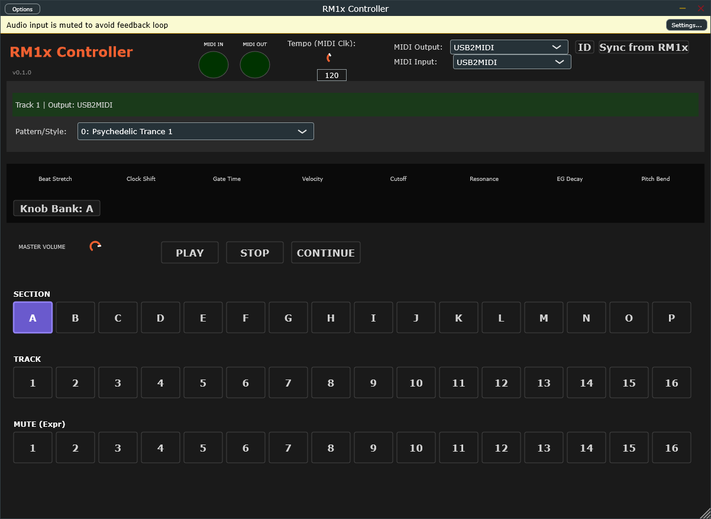

# RM1x Controller

**Controller for Yamaha RM1x Groovebox** — mirrors the hardware panel over MIDI.

A JUCE 8 VST3 + Standalone application that provides a software remote controller for the Yamaha RM1x groovebox. Designed to replace broken physical buttons (Section, Mute, Track) while the unit’s sound engine and MIDI functionality remain intact.

## UI



## Version

**0.2.1** — Standalone releases ASIO/WASAPI + exclusive MIDI on quit

## Downloads

Prebuilt **Windows x64** Standalone and VST3: **[Releases](https://github.com/harisk73/rm1x-controller/releases)** · **[v0.2.1](https://github.com/harisk73/rm1x-controller/releases/tag/v0.2.1)**

- Standalone: unzip and run `RM1x Controller.exe`
- VST3: unzip `RM1x Controller.vst3` into a VST3 folder (e.g. `%USERPROFILE%\Documents\VST3`) and rescan in your DAW

Or build from source below.

## Features

- **MIDI device management** — select MIDI In/Out with activity LEDs labeled **IN** / **OUT**
- **Identity / Sync from RM1x** — query identity and pull pattern/voice state from the hardware
- **Transport** — PLAY / STOP / CONTINUE (MIDI realtime FA / FC / FB)
- **Section control (A–P)** — Section SysEx `F0 43 7E 00 ss 7F F7` (`ss` = `00`–`0F`)
- **Track selection** — select active track (1–16) for voice parameter editing
- **Voice names** — Bank + Program Change mapped to GM/XG display names on the mute row
- **Expression Mute** — per-track mute via **CC#11 Expression** (`0` muted / `127` unmuted) — see caveat below
- **Mute helpers** — Mute All, 1–8, 9–16, Clear, and Solo (muted channels show amber)
- **Master Volume** — Universal SysEx Master Volume `F0 7F 7F 04 01 ll mm F7`
- **Song / Style select** — MIDI Song Select (`F3`) for patterns 0–127
- **MIDI Clock tempo** — send MIDI Clock (`F8`) to drive the RM1x; hardware must be set to **Sync = MIDI**
- **Exclusive MIDI** — host and plugin avoid double-opening the same port
- **Panel-mirror UI** — dark industrial aesthetic with purple-blue active states inspired by the hardware

### What’s new in 0.2.1

- **Standalone device release on quit** — closes MIDI clock/ports and clears callbacks so Windows frees ASIO/WASAPI (and exclusive USB-MIDI) immediately for Studio One / other DAWs
- Patch on top of 0.2.0 UI (voice names, mute helpers, master volume, polish)

### What’s new in 0.2.0

- Voice name labels from Bank MSB/LSB + Program Change (GM + common XG kits)
- Mute helper row: All / 1–8 / 9–16 / Clear / Solo
- Master Volume knob (Universal SysEx)
- UI polish: IN/OUT LED labels, 20×20 circular LEDs, inactive button borders, amber muted channels, layout fixes

## Important: Expression Mute caveat

This controller implements **“Expression Mute”** using **CC#11 (Expression)**, **not** true hardware mute.

The Yamaha RM1x has no documented MIDI SysEx for mute control or mute memory. This implementation:

- Sends CC#11 = 0 (muted) or CC#11 = 127 (unmuted) per track channel  
- Works as a functional mute when the track is not using Expression for other purposes  
- Does **not** access the RM1x’s internal mute memory or mute states  
- UI labels clearly indicate **“Mute (Expr)”** to distinguish from hardware mute  

If true mute SysEx is discovered in the future, the implementation can be updated.

## Hardware setup (required)

Configure your RM1x Utility settings before using this controller:

1. **MIDI Control** → `IN` or `IN/OUT` (`UTILITY → MIDI → MIDI Control`)  
2. **MIDI Sync** → `MIDI` (required for external MIDI Clock tempo) or `INTERNAL` as needed  
3. **Echo Back** → typically `OFF` for direct control  
4. **MIDI Filter → SysEx** → `ENABLED` (Section control requires SysEx reception)  

Typical configuration:

```
UTILITY → MIDI Settings:
  MIDI Control:   IN/OUT
  MIDI Sync:      MIDI
  Echo Back:      OFF
  Filter (SysEx): ENABLED
```

## MIDI protocol (highlights)

### Section Control SysEx (FAQ-confirmed)

```
F0 43 7E 00 ss 7F F7
```

Where `ss` = `00`–`0F` for sections A–P.

> Note: The official List Book shows `ss=08–0F` (likely a typo). This project uses the FAQ-confirmed `00–0F` range.

### Master Volume (Universal SysEx)

```
F0 7F 7F 04 01 ll mm F7
```

14-bit volume; the UI slider sends a 0–127 value scaled to 14-bit.

### Transport

- Start `FA` · Continue `FB` · Stop `FC`

### Song Select

- `F3 nn` — pattern/song number 0–127

### Control Changes used

- CC#7 Volume · CC#10 Pan · CC#11 Expression (mute workaround)  
- CC#71 Resonance · CC#74 Cutoff · CC#91 Reverb Send · CC#93 Chorus Send  

## Build

### Prerequisites

- CMake 3.22+  
- C++17 compiler (MSVC, GCC, or Clang)  
- JUCE 8 (auto-fetched via CMake `FetchContent` if not present)

### Windows (VS 2022 + Ninja)

```cmd
rebuild.bat
```

Or manually:

```cmd
call "C:\Program Files (x86)\Microsoft Visual Studio\2022\BuildTools\Common7\Tools\VsDevCmd.bat" -arch=x64
mkdir build
cd build
cmake .. -G Ninja -DCMAKE_BUILD_TYPE=Release
ninja
```

Built plugins/standalone will be in `build\RM1xController_artefacts\`.

### Install VST3 (Windows)

```powershell
powershell -ExecutionPolicy Bypass -File install-vst3.ps1
```

This copies the VST3 into `%USERPROFILE%\Documents\VST3` (and optionally Common Files if run as Administrator).

### Linux

```bash
cmake -B build
cmake --build build --config Release
```

### macOS

```bash
cmake -B build -G Xcode
cmake --build build --config Release
```

## Usage

1. Launch the standalone app or load the VST3 in your DAW  
2. Select MIDI Output / Input for your RM1x interface  
3. Click **Sync from RM1x** (or Identity) to verify the link  
4. Use Section / Track / Mute (Expr) rows and mute helpers  
5. Set hardware **Sync = MIDI** before using the Tempo (MIDI Clk) control  

## License

MIT — see [LICENSE](LICENSE).

## Troubleshooting

### Transport doesn’t respond
- Check `UTILITY → MIDI → MIDI Control` is `IN` or `IN/OUT`

### Sections don’t change
- Verify SysEx filter is enabled  
- Hardware must be in Pattern or Song mode  

### Mute not working
- Expression Mute uses CC#11; ensure the track voice isn’t heavily using Expression  
- This is **not** true hardware mute — see caveat above  

### Double / echo sound
- Avoid opening the same physical MIDI port as both host MIDI out **and** plugin direct out  
- Use host routing **or** plugin direct routing, not both  

## Credits

Developed for users with broken RM1x panels who need software control.
